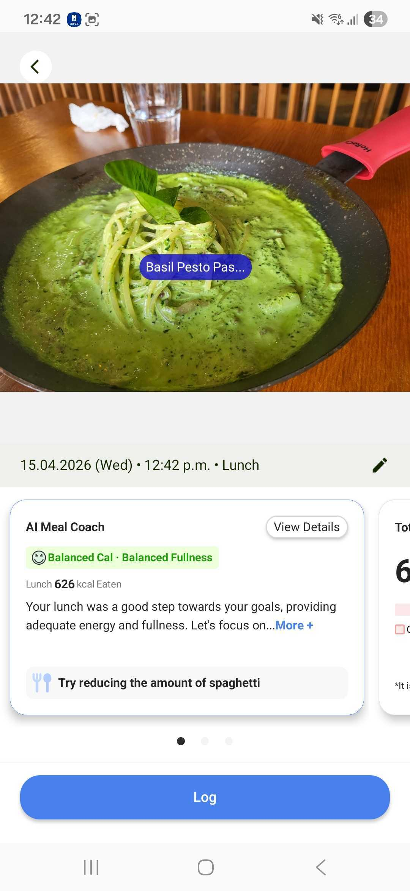
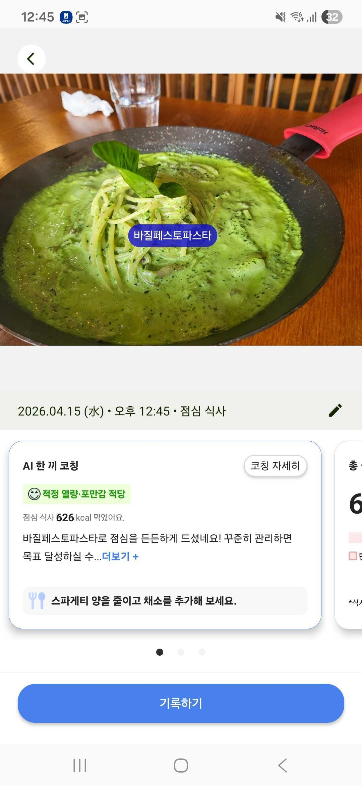
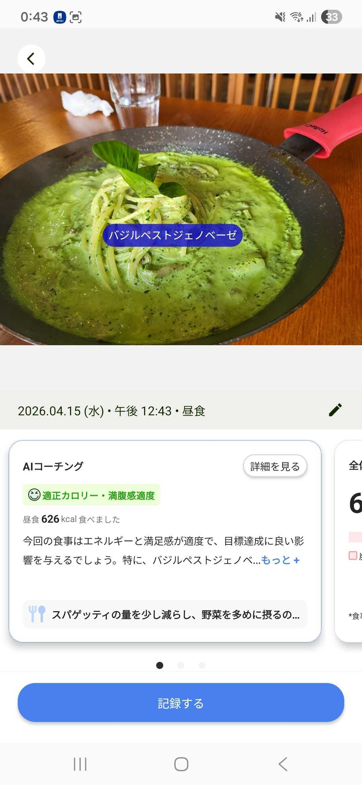
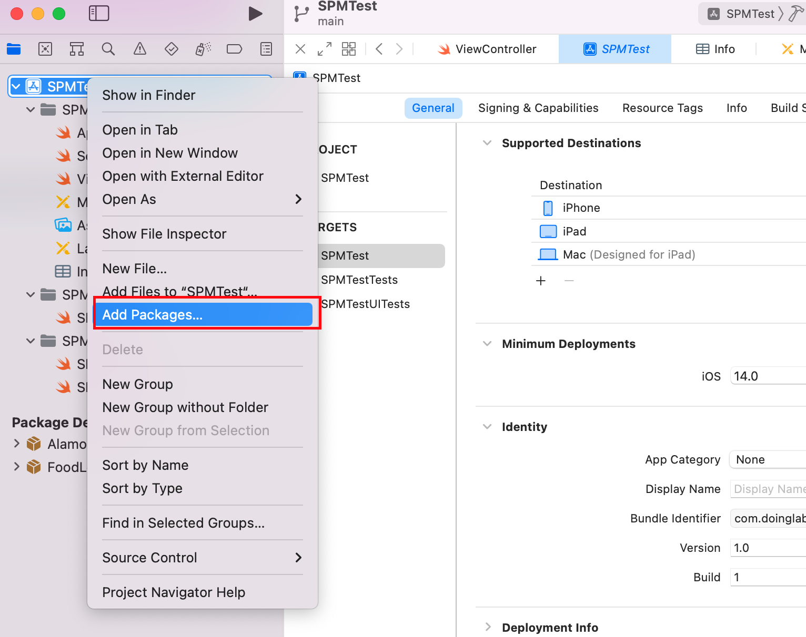
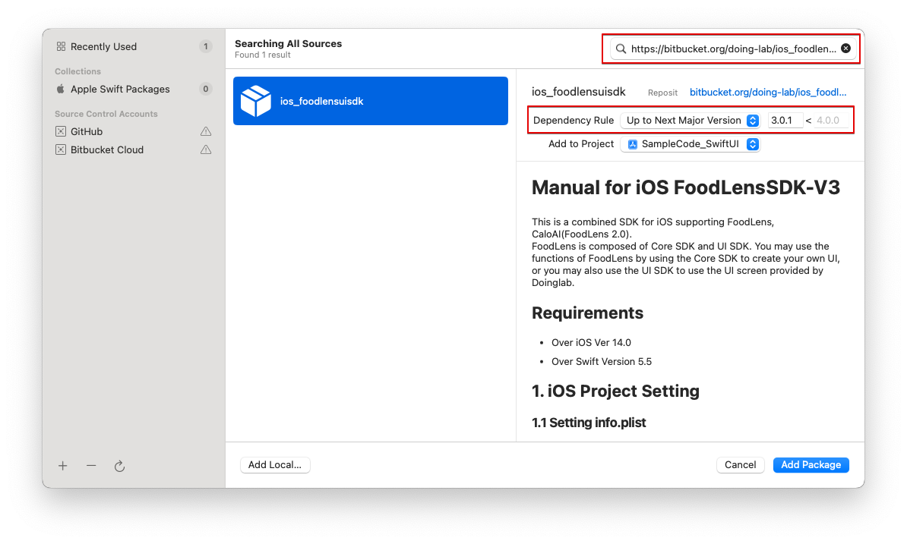

# FoodLens SDK V3 — AI Food Recognition SDK for Android & iOS

**Get calories and 36 nutrients from a single food photo.**
FoodLens is an AI food image recognition engine by [Doinglab](https://www.doinglab.com). This repository contains the Android and iOS SDKs for **FoodLens** and **CaloAI (FoodLens 2.0)**.

[Website](https://foodlens.ai) · [REST API docs](https://foodlens.ai/docs/) · [Android manual](Android/) · [iOS manual](IOS/) · [한국어 안내](#한국어)

| English | 한국어 | 日本語 |
| --- | --- | --- |
|  |  |  |

## Features

- **Multi-food recognition** — detects every dish on the table in one photo and returns each food's position in the image.
- **36+ nutrients + food groups** — calories, carbohydrate, protein, fat, sugars, fiber, sodium, cholesterol, vitamins, minerals, amino acids, fatty acids, and food exchange groups (CaloAI).
- **Ingredients** — ingredient list with weights for each food.
- **Global cuisine** — recognizes Korean to international dishes; estimates foods not in the dataset from their ingredients.
- **Multilingual results** — CaloAI: Korean, English, Japanese. FoodLens: Korean, English.
- **Core SDK or UI SDK** — build your own screens with the Core SDK, or ship the ready-made camera, result, and food-search screens with the UI SDK.
- **REST API** — the same recognition is available as a REST API. See the [API docs](https://foodlens.ai/docs/).

## Requirements

| | Android | iOS |
| --- | --- | --- |
| OS | minSdkVersion 26+, compileSdkVersion 35 | iOS 14.0+ |
| Build | AGP 8.1+ for UI SDK 3.4.4 and later | Swift tools 5.10 (Xcode 15.3+) for UI SDK 3.4.5 |
| Install | Gradle | Swift Package Manager |
| Latest | Core 3.4.4 · UI 3.4.5 | Core 3.4.3 · UI 3.4.5 |

Check the latest versions in the release notes: [Android](Android/ReleaseNote.md) · [iOS](IOS/ReleaseNote.md)

## Quick start

An AppToken and CompanyToken are required. They are issued after you contact us (see [Getting access](#getting-access)).

### Android

```gradle
dependencies {
    // Core SDK only
    implementation "com.doinglab.foodlens:FoodLensSDK-core:3.4.4"
    // With UI SDK
    implementation "com.doinglab.foodlens:FoodLensSDK-ui:3.4.5"
}
```

```kotlin
// Choose FoodLensType.FoodLens or FoodLensType.CaloAI
val foodLensCoreService = FoodLensCore.createFoodLensService(context, FoodLensType.CaloAI)

foodLensCoreService.predict(jpegBytes, object : RecognitionResultHandler {
    override fun onSuccess(result: RecognitionResult?) {
        // foods, positions, nutrients
    }
    override fun onError(error: BaseError?) {
        Log.d("FoodLens", error?.getMessage() ?: "")
    }
})
```

Full guide: [Android manual](Android/README.md) · [한국어](Android/README_KO.md)

### iOS

Add the package with **File > Add Package Dependencies**:

- Core SDK only: `https://bitbucket.org/doing-lab/ios_foodlenscoresdk`
- With UI SDK: `https://bitbucket.org/doing-lab/ios_foodlensuisdk`

<br>


```swift
// Choose .foodlens or .caloai
let foodlensCoreService = FoodLensCoreService(type: .caloai)

Task {
    let result = await foodlensCoreService.predict(image: image, userId: userId)
    switch result {
    case .success(let response):
        // foods, positions, nutrients
        break
    case .failure(let error):
        print(error)
    }
}
```

Full guide: [iOS manual](IOS/README.md) · [한국어](IOS/README_KO.md)

## UI SDK screens

The UI SDK ships ready-made camera, result, and food-search screens. On the summary screen, `nutrientSummaryDisplayOption` controls how nutrients appear.

| HIDDEN | PERCENTAGE | WEIGHT |
| --- | --- | --- |
|  |  |  |

UI settings: [Android](Android/README.md) · [iOS](IOS/README.md)

## Result example

Each recognized food comes with its name, position, serving size, ingredients, and nutrients. Nutrient values are per one serving (`servingSize`).

```json
{
  "name": "Oil Pasta",
  "fullName": "Prawn Oil Pasta",
  "position": { "xmin": 27, "xmax": 712, "ymin": 43, "ymax": 508 },
  "servingSize": 388.0,
  "unit": "g",
  "ingredients": [
    { "name": "Noodles", "gram": 250.0 },
    { "name": "Prawn", "gram": 80.0 },
    { "name": "Oil", "gram": 50.0 }
  ],
  "energy": 872.21,
  "carbohydrate": 68.36,
  "protein": 25.46,
  "fat": 51.9,
  "sodium": 1043.66
}
```

All fields and units: [JSON Format](JSON%20Format) · [JSON Sample](JSON%20Sample) · [API docs](https://foodlens.ai/docs/#nutrients)

## Getting access

1. Contact **sales@doinglab.com**.
2. After the contract, you receive an AppToken and CompanyToken (and REST API details if needed).
3. Every plan includes a **3-month free trial** for development and testing.

Try it first without coding: [Diet Camera app](https://dietcamera.doinglab.com/) uses FoodLens for food recognition and AI meal coaching.

Pricing: [foodlens.ai/#pricing](https://foodlens.ai/#pricing)

## Documentation

| Topic | Android | iOS |
| --- | --- | --- |
| Manual | [EN](Android/README.md) · [KO](Android/README_KO.md) | [EN](IOS/README.md) · [KO](IOS/README_KO.md) |
| Release notes | [ReleaseNote](Android/ReleaseNote.md) | [ReleaseNote](IOS/ReleaseNote.md) |
| Migrating from V2 | [Guide](Android/Migration_Guide_Android_V2_to_V3.md) · [Types](Android/Type_Conversion_V3_V2.md) | [Guide](IOS/Migration_Guide_iOS_V2_to_V3.md) · [Types](IOS/Type_Conversion_V3_V2.md) |
| Feedback API | [EN](Android/Feedback_guide_EN.md) · [KO](Android/Feedback_guide_KO.md) | [EN](IOS/Feedback_guide_EN.md) · [KO](IOS/Feedback_guide_KO.md) |
| REST API | [foodlens.ai/docs](https://foodlens.ai/docs/) | [foodlens.ai/docs](https://foodlens.ai/docs/) |

## Who uses FoodLens

More than 100 companies use FoodLens in healthcare, insurance, diabetes care, fitness, and employee wellness services.

## Contact

- Email: sales@doinglab.com
- Phone: +82-2-6959-5657
- Website: https://foodlens.ai

---

## 한국어

**FoodLens SDK V3 — 사진 한 장으로 칼로리와 36종 영양소를 알려 주는 AI 음식 인식 SDK (Android·iOS)**

FoodLens(푸드렌즈)는 두잉랩의 AI 음식 이미지 인식 엔진입니다. 이 저장소에는 **FoodLens**와 **CaloAI(FoodLens 2.0)**용 Android·iOS SDK가 있습니다.


- **멀티 인식**: 사진 한 장에서 여러 음식을 각각 인식하고 위치를 알려 줍니다.
- **36종 이상 영양소 + 식품군**: 칼로리, 탄단지, 당류, 식이섬유, 나트륨, 비타민·무기질, 아미노산, 지방산, 식품교환단위(CaloAI)
- **재료 정보**: 음식별 재료 목록과 무게
- **다국어 결과**: CaloAI 한국어·영어·일본어, FoodLens 한국어·영어
- **Core SDK / UI SDK**: 직접 화면을 만들거나, 카메라·결과·음식 검색 화면을 그대로 쓸 수 있습니다.
- **REST API**: [API 문서](https://foodlens.ai/docs/)

**도입**: sales@doinglab.com으로 문의하시면 계약 후 AppToken·CompanyToken을 발급해 드립니다. 모든 플랜에 3개월 무료 테스트가 포함됩니다.

설명서: [Android](Android/README_KO.md) · [iOS](IOS/README_KO.md) · 웹사이트: [foodlens.ai](https://foodlens.ai)
